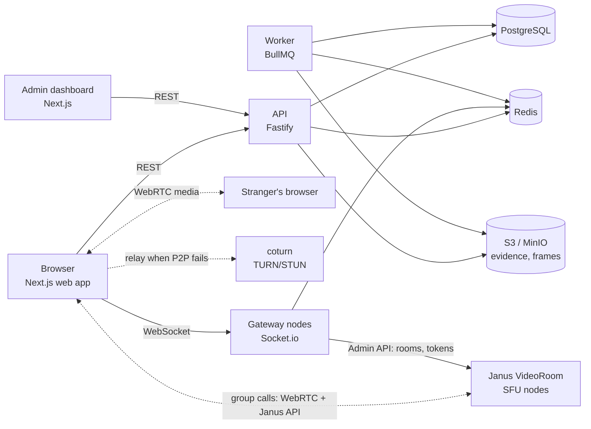

# RandomChat

Anonymous random text and video chat. Visitors pass an age and bot check, get paired with a
random stranger in milliseconds, and can skip to the next one at any time; a video call can grow
to four strangers when everyone agrees. 1:1 video is peer-to-peer WebRTC, group calls run through
a Janus SFU; matchmaking, text relay and signalling run on a horizontally scalable Socket.io
gateway backed by Redis. Trust & safety (text filtering, risk-based video sampling, reports with evidence,
shadow and hard bans) and a moderator dashboard are built in.

|            |                                                                                                                                                                                                              |
| ---------- | ------------------------------------------------------------------------------------------------------------------------------------------------------------------------------------------------------------ |
| **Status** | Feature-complete development build (Parts 1–12): 1:1 text and video chat, and video calls of up to four people through a Janus SFU. **Not yet launched:** see [Production readiness](#production-readiness). |
| **Tested** | 372 unit/integration tests, 12 Playwright end-to-end tests (incl. a four-person call, + a Janus failover drill), load tests with 5,000 concurrent clients, crash drills for gateway, Redis and worker        |
| **Docs**   | [Developer guide](docs/DEVELOPMENT.md) · [LAN testing](docs/LAN_TESTING.md)                                                                                                                                  |

## Contents

- [Features](#features)
- [Architecture](#architecture)
- [Tech stack](#tech-stack)
- [Quick start (local)](#quick-start-local)
- [Production deployment](#production-deployment)
- [Scaling](#scaling)
- [Security and privacy](#security-and-privacy)
- [Production readiness](#production-readiness)
- [Testing and CI](#testing-and-ci)
- [Repository layout](#repository-layout)

## Features

**Chat**

- Random 1:1 **text** or **video** chat, no account needed; optional interests and language.
- Matching in milliseconds (p95 under 50 ms at 5,000 concurrent clients); **Next** skips, **Stop**
  ends, auto-search for the next stranger.
- Survives network drops and server restarts: a disconnected user has a grace period to reconnect
  to any gateway and resume the same chat, including missed messages.
- Video: pre-join camera/microphone check, device pickers, peer-to-peer WebRTC with TURN fallback,
  optional relay-only mode that hides each user's IP address from the stranger.
- **Group video of up to four:** anyone in a video call can ask to add a person; only if everyone
  agrees does the call look for one more stranger, and only visitors who opted in are ever
  added. 2×2 grid (stacked on phones) with a report button and connection badge per person and a
  highlight on whoever is speaking; someone leaving doesn't end the call for the others.

**Trust & safety**

- Age confirmation, Terms acceptance and Cloudflare Turnstile before every session.
- Text filter: links, emails, phone numbers, "add me on…" and slurs are blocked before relaying
  (obfuscated forms too); other profanity is masked.
- Video moderation: on-device NSFW check plus server-side frame sampling by risk tier (new and
  low-trust users more often), capped by a global budget.
- Reports with evidence (recent messages, the stranger's last few frames), trust scores, automatic
  shadow bans (offenders are only matched with each other) and hard bans that take effect live.
  In group calls a report names one person, and a ban removes only them from the call.
- Group calls are limited to trusted visitors (trust score threshold for everyone in the call and
  the newcomer) and sampled at the highest moderation tier.

**Admin dashboard**

- Live stats, prioritised report queue with keyboard triage, evidence blurred until clicked, ban
  and trust decisions, visitor history, audit log, admin accounts with roles and mandatory TOTP.
- Reports from group calls list everyone who was in the chat and which of them sent each message.

## Architecture



- **Gateways are stateless.** Matchmaking runs as atomic Lua scripts in Redis, so any number of
  gateway nodes share the same queues without double-matching anyone. Nodes talk to each other
  through the sharded Socket.io Redis adapter and a control channel.
- **Media never touches the app servers.** Two-person video is peer-to-peer (DTLS-SRTP); coturn
  relays only when a direct path fails or relay mode is forced. Group calls run through **Janus
  VideoRoom** (each person uploads once, Janus forwards); a P2P call switches to Janus
  make-before-break, without a visible freeze. The gateway places rooms on the least-loaded healthy
  Janus node, issues per-participant signed tokens and moves calls to another node if one fails.
- **Redis holds everything live** (queues, sessions, presence, rate limits, caches); every key has
  a TTL. **PostgreSQL holds only what must last:** visitors (hashed identifiers), reports,
  evidence metadata, bans, moderation events, admins, audit logs, session metadata.
- **The worker** handles background jobs: session logs, frame classification, moderation events,
  report thresholds and data retention.

## Tech stack

| Layer               | Technology                                                                                                                                 |
| ------------------- | ------------------------------------------------------------------------------------------------------------------------------------------ |
| Language / monorepo | TypeScript 6 (strict, ESM), pnpm 12 workspaces, Turborepo                                                                                  |
| Web and admin       | Next.js 16 (App Router), React 19, Tailwind CSS 4, shared UI kit in `packages/ui` (shadcn/ui-style, some components adapted from 21st.dev) |
| API                 | Fastify 5, Zod validation, JWT visitor tokens (jose), argon2id + TOTP for admins                                                           |
| Real-time           | Socket.io 4 with the sharded Redis adapter (ioredis)                                                                                       |
| Data                | PostgreSQL 18 + Prisma 7, Redis 8 (Lua matchmaking), S3-compatible storage (MinIO in development)                                          |
| Jobs                | BullMQ                                                                                                                                     |
| Media               | WebRTC, coturn 4.18; Janus 1.4.3 VideoRoom (built from source, VideoRoom + WebSockets only) for group calls                                |
| Safety              | Cloudflare Turnstile, obscenity text filter, NSFWJS in the browser, pluggable server classifier and CSAM hash matcher                      |
| Observability       | pino logs (redacted), Prometheus metrics, Grafana dashboard                                                                                |
| Quality             | Vitest, Testing Library, Playwright, ESLint, Prettier, GitHub Actions, gitleaks, Dependabot                                                |

## Quick start (local)

Requires **Node.js 24**, **pnpm 12** (`corepack enable pnpm`) and **Docker** with Compose v2.

```bash
pnpm install
cp .env.example .env    # replace the "dev-only" secrets, e.g. `openssl rand -hex 32`
pnpm infra:up           # Postgres, Redis, coturn, MinIO, Janus (first run builds Janus: ~5 min)
pnpm db:migrate
pnpm db:seed            # dev admin + sample data
pnpm dev
```

| App           | URL                                                                                           |
| ------------- | --------------------------------------------------------------------------------------------- |
| Chat          | <http://localhost:3000> (open two separate windows, e.g. one private, to chat with yourself)  |
| Admin         | <http://localhost:3001> (sign in with `SEED_ADMIN_EMAIL` / `SEED_ADMIN_PASSWORD` from `.env`) |
| API / gateway | <http://localhost:4000> / <http://localhost:4001>                                             |

The bot check uses Cloudflare's test keys but still needs internet access. Every script, run mode,
test command and troubleshooting tip is in the [developer guide](docs/DEVELOPMENT.md).

## Production deployment

Read [Production readiness](#production-readiness) first: the code is ready to deploy to a
staging environment, but launching to real users needs the work listed there.

### 1. Services to run

| Service | Image                                   | Port                                                            | Health                                             | Scale                                                                  |
| ------- | --------------------------------------- | --------------------------------------------------------------- | -------------------------------------------------- | ---------------------------------------------------------------------- |
| web     | `apps/web/Dockerfile`                   | 3000                                                            | `GET /`                                            | Stateless, behind a CDN                                                |
| admin   | `apps/admin/Dockerfile`                 | 3001                                                            | `GET /login`                                       | 1–2 replicas, behind an access proxy/VPN                               |
| api     | `apps/api/Dockerfile`                   | 4000                                                            | `/health`, `/ready`                                | Stateless, scale on CPU                                                |
| gateway | `apps/gateway/Dockerfile`               | 4001                                                            | `/health`, `/ready`                                | Stateless, scale on socket count (~2,500 sockets per process measured) |
| worker  | `apps/worker/Dockerfile`                | 4002 (`/health`, `/metrics` only)                               | `/health`                                          | Scale on job backlog                                                   |
| migrate | `apps/api/Dockerfile`, target `migrate` | —                                                               | exits 0                                            | Run once per release, before the apps                                  |
| janus   | `infra/docker/janus/Dockerfile`         | 8188 (Janus API, wss), 7188 (Admin API, private), RTP UDP range | TCP on 8188/7188; the gateway checks the Admin API | One per media host; the gateway fails calls over between nodes         |

Infrastructure: PostgreSQL (managed, HA, with PgBouncer), Redis with replicas and failover (split
the BullMQ Redis with AOF from the ephemeral one), S3-compatible object storage, coturn on hosts
with public IPs (start from [`infra/coturn/turnserver.production.conf`](infra/coturn/turnserver.production.conf)),
Prometheus + Grafana.

### 2. Build the images

All images build from the repository root. They are multi-stage, run as the non-root `node` user
and include a `HEALTHCHECK`. Web and admin inline their public URLs at build time, so build them
once per environment:

```bash
docker build -f apps/api/Dockerfile     -t randomchat/api .
docker build -f apps/api/Dockerfile     -t randomchat/migrate --target migrate .
docker build -f apps/gateway/Dockerfile -t randomchat/gateway .
docker build -f apps/worker/Dockerfile  -t randomchat/worker .

docker build -f apps/web/Dockerfile -t randomchat/web \
  --build-arg DEPLOY_ENV=production \
  --build-arg NEXT_PUBLIC_API_URL=https://api.example.com \
  --build-arg NEXT_PUBLIC_GATEWAY_URL=wss://rt.example.com \
  --build-arg NEXT_PUBLIC_TURNSTILE_SITE_KEY=<site key> \
  --build-arg NEXT_PUBLIC_FORCE_TURN_RELAY=false .

docker build -f apps/admin/Dockerfile -t randomchat/admin \
  --build-arg NEXT_PUBLIC_API_URL=https://api.example.com \
  --build-arg S3_PUBLIC_ENDPOINT=https://evidence.example.com .
```

To try the production images locally, `pnpm stack:up` builds and runs all of them with Docker
Compose (`pnpm stack:down` stops them).

### 3. Configure

Every variable and its development default is listed in [`.env.example`](.env.example). In production, inject them from a secrets manager (never commit
`.env`). With `DEPLOY_ENV=production` the services **refuse to start** with placeholder secrets,
Turnstile test keys or `NODE_ENV` other than `production`.

| Group         | Variables                                                                                                                                                                                                                                                                                             |
| ------------- | ----------------------------------------------------------------------------------------------------------------------------------------------------------------------------------------------------------------------------------------------------------------------------------------------------- |
| Environment   | `NODE_ENV=production`, `DEPLOY_ENV=production` (`staging` in staging), `LOG_LEVEL=info`                                                                                                                                                                                                               |
| Secrets       | `JWT_SECRET`, `IP_HASH_PEPPER`, `DEVICE_HASH_PEPPER`, `TURN_SECRET`, `ADMIN_TOTP_ENC_KEY`, `TURNSTILE_SECRET_KEY`, `S3_ACCESS_KEY`, `S3_SECRET_KEY`, `METRICS_TOKEN`                                                                                                                                  |
| Data stores   | `DATABASE_URL` (via PgBouncer; migrations use a direct URL), `REDIS_URL` (`rediss://`), `S3_ENDPOINT`, `S3_PUBLIC_ENDPOINT`, `S3_REGION`, `S3_BUCKET_EVIDENCE`, `S3_BUCKET_FRAMES`                                                                                                                    |
| Network       | `CORS_ORIGINS` (web origins, also the WebSocket allowlist), `ADMIN_ORIGINS`, `TRUST_PROXY` (exact hop count or CIDRs of your CDN/load balancer, never `true`), `TURNSTILE_HOSTNAMES`                                                                                                                  |
| Media         | `TURN_HOST`, `TURN_PORT`, `TURN_TLS_PORT=443`, `STUN_URLS`, `TURN_CREDENTIAL_TTL_SECONDS`                                                                                                                                                                                                             |
| Group video   | `JANUS_NODES` (gateway and web: `wsUrl` for browsers, `adminUrl` private), `JANUS_ADMIN_SECRET`, `JANUS_TOKEN_SECRET` (also given to each Janus node), `JANUS_PUBLIC_IP` (per node), `SFU_PUBLISHER_BITRATE`, `SFU_UPGRADE_TIMEOUT_MS`, `GROUP_MIN_TRUST` (default 60), `SEEK_PARTICIPANT_TIMEOUT_MS` |
| Capacity      | `MM_REGION`, `MM_BUCKETS`, `MM_BUCKETS_BY_QUEUE`, `DEADLINE_SHARDS=64`, `STATS_COUNTER_SHARDS`, `WORKER_CONCURRENCY`, `MOD_FRAME_BUDGET_PER_SEC`, `HANDSHAKE_LIMIT_PER_IP`                                                                                                                            |
| Must stay off | `RATE_LIMIT_DISABLED`, `DEV_FORCE_FLAG_VISITOR_IDS`, `DEV_FORCE_SFU` (all ignored outside development)                                                                                                                                                                                                |

Bucket and shard counts can only be **raised** on a live fleet; lowering them orphans waiting
tickets or deadlines.

### 4. Release

1. Run the `migrate` image against the database (`prisma migrate deploy`). Migrations must stay
   backward compatible with the running version.
2. Roll out api, worker, gateway, then web and admin.
3. Gateways drain on `SIGTERM`: they stop accepting connections, tell clients to reconnect
   elsewhere and exit within 20 s, and the clients resume their chats on another node. Set
   `terminationGracePeriodSeconds` above 20 s and use a PodDisruptionBudget.
4. First release only: create the first admin, then enrol TOTP immediately (it is mandatory in
   production):

   ```bash
   ADMIN_EMAIL=you@example.com ADMIN_PASSWORD='<at least 12 chars>' ADMIN_ROLE=ADMIN pnpm admin:create
   ```

### 5. Networking

- HTTPS/WSS everywhere with HSTS; a CDN + WAF in front of web, API and admin, with edge rate
  limits on `/v1/session`, `/v1/reports`, `/v1/moderation/frames` and admin login.
- The gateway uses WebSocket transport only, so **no sticky sessions** are needed. Set the load
  balancer idle timeout above 45 s (ping 25 s + timeout 20 s).
- Keep `/ready`, `/health` and `/metrics` off the public ingress. Prometheus scrapes `/metrics`
  with `Authorization: Bearer $METRICS_TOKEN`; without a token, `/metrics` is disabled in
  production.
- Admin dashboard behind an access proxy, VPN or IP allowlist, on the same registrable domain as
  the API (the admin cookie is `SameSite=Lax`).
- TURN needs public IPs, a wide UDP relay port range, TLS on 443 and network-level DDoS protection.
- Janus nodes need public IPs (`JANUS_PUBLIC_IP`) with their RTP UDP range open and the Janus API
  behind TLS (wss). The **Admin API port must only be reachable from the gateways** (private
  network); it is protected by `JANUS_ADMIN_SECRET`, and the web CSP only allows the nodes'
  client URLs. Nodes must not be shared between environments (orphaned rooms are destroyed).

### 6. Monitor

Import [`infra/docker/grafana/dashboards/randomchat.json`](infra/docker/grafana/dashboards/randomchat.json).
Alert at least on: `gateway_adapter_subscriber_oldest_pending_seconds` > 15 (cross-node delivery
failing; the gateway's `/health` also turns 503 so the pod is replaced), drops in
`gateway_sockets_connected`, time-to-match p99, error rates, Redis latency and memory, BullMQ
backlog and failures, TURN relay share, `sfu_node_healthy` = 0, `sfu_failovers_total`,
`sfu_upgrades_total{outcome="rolled_back"}` and `group_seeks_total{outcome="unavailable"}`.

## Scaling

Measured on one laptop (Apple M2 Pro) with two gateway nodes and an aggressive profile (sessions
of ~20 s, half video):

| Concurrent clients | Time to match p50 / p95 / p99 | Message latency p95 | Gateway CPU per node |
| ------------------ | ----------------------------- | ------------------- | -------------------- |
| 2,000              | 9 / 35 / 62 ms                | 3 ms                | ~28 % of one core    |
| 5,000              | 14 / 28 / 38 ms               | 7 ms                | ~62 % of one core    |

- **Gateways** scale out linearly: ~2,500 sockets per Node.js process at ~60 % of a core and
  ~550 MB.
- **Redis** is the first limit: one instance handles an estimated 10–20k concurrent users. Beyond that,
  Redis Cluster is needed. Keys are already hash-tagged for it: matchmaking queues are split into
  buckets that land on different shards, and hot keys (deadlines, counters) are sharded.
- **TURN bandwidth** is the largest cost: each relayed call is up to 800 kbps per direction.
- **Projection for 1M concurrent users** (not yet validated): ~150–400 gateway processes,
  ~50–120 Redis shards, a TURN fleet in the hundreds of Gbps. Validating it needs a distributed
  bot fleet.

## Security and privacy

- Anonymous by design: no accounts for visitors; IP addresses and device ids are stored only as
  HMAC hashes; chat text is never logged or stored outside report evidence.
- Visitor JWTs (12-hour lifetime, kept in memory and `sessionStorage`, no cookies); admin sessions in Redis
  with CSRF tokens, argon2id passwords, mandatory TOTP and RBAC; every admin action audited.
- Zod validation on every HTTP route and socket event; per-socket rate limits and abuse
  disconnects; per-IP and per-visitor handshake limits; WebSocket Origin allowlist.
- Nonce-based Content Security Policy on web and admin; uploads size-limited, magic-byte checked
  and re-encoded; evidence served only through 5-minute presigned URLs, blurred by default.
- TURN credentials are short-lived HMAC credentials; the production coturn config denies relays to
  private and reserved ranges (checked in CI).
- Logs are redacted (tokens, IPs, device ids, chat text) and tests assert it.

Found a vulnerability? Please report it privately to the maintainer rather than opening a public
issue.

## Production readiness

The software side is complete for 1:1 chat and group video calls. What remains before real users
is mostly infrastructure, legal and operational work. The launch blockers include:

- **Legal:** launch countries decided with counsel; reviewed Terms, Privacy Policy and Community
  Guidelines (the current pages are placeholders); NCMEC registration (US); GDPR, DSA, UK Online
  Safety Act and India IT Rules obligations; licence checks.
- **Safety:** an age-assurance vendor where required; a real image classifier and CSAM hash
  matching (PhotoDNA or Thorn Safer) in place of the development mock and no-op; 24/7 moderation
  staffing, moderator wellbeing and an appeals process.
- **Infrastructure:** Kubernetes, HA Postgres + PgBouncer, replicated Redis, TURN fleet, CDN/WAF,
  secrets manager, backups with restore drills, alerting, on-call runbooks, a penetration test.

## Testing and CI

```bash
pnpm lint && pnpm typecheck && pnpm test && pnpm build   # quality gate (needs `pnpm infra:up`)
pnpm test:coverage                                       # with coverage thresholds
pnpm test:e2e                                            # Playwright: text, video, restart, reports, bans, Janus, group calls
```

GitHub Actions ([`.github/workflows/ci.yml`](.github/workflows/ci.yml)) runs lint, typecheck,
tests with coverage against real Postgres, Redis and MinIO, the build, `pnpm audit`, a gitleaks
secret scan and a check of the production TURN config. The end-to-end workflow runs manually.
Load testing and Redis inspection tools are described in the
[developer guide](docs/DEVELOPMENT.md#load-testing).

## Repository layout

```
apps/
  web/        Next.js chat app (port 3000)
  admin/      Next.js moderator dashboard (port 3001)
  api/        Fastify REST API (port 4000)
  gateway/    Socket.io gateway: matchmaking, text relay, WebRTC signalling (port 4001)
  worker/     BullMQ jobs: session logs, moderation, retention (metrics on 4002)
packages/     config, env, logger, metrics, shared (types + schemas), ui, db (Prisma), redis,
              matchmaking (Lua), moderation, storage, sfu (Janus Admin API, tokens, node health)
e2e/          Playwright suite
infra/        Docker Compose (local infra, `full` and `observability` profiles), coturn, Janus,
              Prometheus, Grafana
tools/bots/   Correctness bots, load generator, Redis inspector
docs/         Developer guide, LAN testing
```
